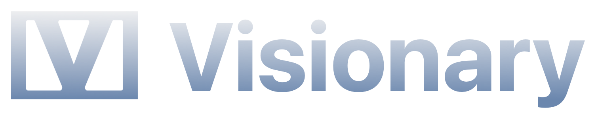

  

**An overnight appliance that upscales your Plex library to 4K Dolby Vision™ — unattended.**

Point Visionary at your TV shows, movies and YouTube channels, arm it, and walk away. It
takes each one through Topaz Video AI, makes a **real Dolby Vision™ 8.1 master** — the picture
measured shot by shot into Dolby Vision metadata, not an HDR tone-map — encodes a peak-capped
x265, and files it back into your library in place of the 1080p original (or beside it, your
call). Then it starts the next one. It stays out of your way while you're watching Plex,
refuses to run on a machine that can't sustain the power draw, and picks up mid-episode
after a restart without redoing finished work.

The Dolby Vision™ step runs entirely headless: a pinned SDR→PQ conversion, then
[hdr-analyze](https://github.com/tinof/hdr-analyze) measures every shot of the finished
picture and [dovi_tool](https://github.com/quietvoid/dovi_tool) writes the Dolby Vision
metadata from those measurements. No editing app and no screen involved. The toolchain is
pinned to exact builds, because every master's colour and metadata were judged on those
builds, and that is what separates the output from the usual "HDR-ish" upscale.

**See it on real footage:** [download the sample stills](https://github.com/adamkbritsch/visionary/releases/download/samples-lost-s01e01/visionary-lost-s01e01-samples.zip)
— six moments from the pilot of *Lost*, upscaled from 1080p to 4K Dolby Vision™ and set against the
original as side-by-sides, zoomed crops and isolated frames. One 106 MB zip of the whole folder; the
HDR images are AVIF and need an HDR screen to show their highlights. Or [browse them](docs/samples/lost-s01e01).

Optionally, AI border extension fills 4:3 shows out to 16:9 before upscaling.

Arm it in the evening; wake up to finished episodes.

  

<b>Two episodes in flight at once</b> — S03E10 upscaling in Topaz while S03E09's Dolby Vision™ remux runs beside it, each with its own segmented, resumable progress and its own estimate.

> [!IMPORTANT]
> **Visionary runs the GPU flat out for hours.** It checks your setup at launch and won't
> start if it can't work properly. What it needs:
>
> | Requirement | What works |
> |---|---|
> | Mac | **Any desktop Mac** (mini, Studio, iMac), or a **16-inch MacBook Pro** on its 140 W charger. A 14-inch MacBook Pro (M1/M2) or a MacBook Air can't sustain the power draw and is refused; a laptop too new for the model lists is judged by its live charger reading instead (see below). |
> | Topaz Video AI | **7.0.1** — this exact build |
> | Dolby Vision™ toolchain | Homebrew **ffmpeg 8** (Setup installs it — see [step 3](docs/SETUP.md#3-command-line-tools)). Everything else — **dovi_tool 2.3.0**, the **hdr_analyzer_mvp** build and the **SDR→PQ LUT** — ships with Visionary in [`dv/`](dv/README.md) and installs itself — see [step 4](docs/SETUP.md#4-dolby-vision-toolchain) |
> | Local scratch | a **fast SSD with ~1 TB free** — the working files are enormous (see [Known limitations](docs/LIMITATIONS.md)) |
> | NAS | reachable over FTP, hosting your media (a Plex server is **optional** — see [Configuration](docs/CONFIGURATION.md)) |
> | AI border extension | **optional.** Requires the **[Comfy Desktop](https://www.comfy.org/) app** (run once so it builds its ComfyUI + venv — a hand-cloned ComfyUI is not detected), its **ComfyUI-VideoHelperSuite** node from Manager, and ~11.4 GB of WAN 2.1 models Visionary downloads for you from Settings → Setup. Without all of it, everything else works unchanged — the feature simply never appears. See [step 11](docs/SETUP.md#11-ai-border-extension--optional-only-for-43-shows). |
>
> **Why the power rule?** Topaz pushes the GPU for hours. A desktop Mac is plugged into the
> wall, so it always qualifies. A laptop is judged by its model rather than by the charger
> you plugged in — because a 140 W charger connected to a laptop that can only draw 96 W
> still reports "140 W". A laptop too new to be on the list isn't blocked: Visionary falls
> back to checking the charger, and warns. On a MacBook, a **closed lid** pauses the run
> unless you allow it to stay awake — one optional command, see
> [step 12](docs/SETUP.md#12-lid-closed--optional-macbook-only).
>
> Topaz Video AI is a commercial product — bring your own license.

## Install

The easy path — no clone, no Terminal for most of it:

1. **Download** the latest `Visionary-vX.zip` from
   [Releases](https://github.com/adamkbritsch/visionary/releases) and unzip it.
2. **Drag Visionary.app to /Applications.** This step is required, not cosmetic: macOS
   runs a quarantined app opened elsewhere from a randomized read-only path (App
   Translocation).
3. **Right-click → Open** the first time (the app isn't notarized; macOS asks once).
4. Install **Topaz Video AI 7.0.1**, the exact build ([where to get it](docs/SETUP.md#2-install-topaz-video-ai--exact-version)). It is licensed software; the app detects it but can't install it for you.
5. Open the **gear → Settings → Setup** section. Everything else lives there, with a
   live check beside each item: your NAS connection (and the optional Plex / TMDb /
   youtarr / Shuttle fields), **one-click installs** for the command-line dependencies and
   the Dolby Vision™ toolchain, and the optional NAS DV-probe helper with its cron line. The
   section stays expanded until every check is green, then tucks itself away.
6. *Optional* — want [4:3 shows widened to 16:9](docs/SETUP.md#11-ai-border-extension--optional-only-for-43-shows)?
   Install the free **[Comfy Desktop](https://www.comfy.org/)** app, **launch it once**,
   add **ComfyUI-VideoHelperSuite** from its Manager, then back in Setup use the *Border
   extender* group's one-click downloads for the ~11.4 GB of models. Skip this and the
   feature simply never appears — nothing else needs it.
7. *Optional, MacBook only* — want it to keep running with the **lid closed** and no
   screen attached? Run the one command Setup shows under *Applications & hardware → Lid
   closed* (see [step 12](docs/SETUP.md#12-lid-closed--optional-macbook-only)). It asks for your password
   once. Skip it and a closed lid simply sleeps the Mac, as it always did.

The pipeline won't arm until the exact Topaz build and the Dolby Vision™ toolchain are in
place and the dependencies exist — and it names exactly what's missing rather than failing
mid-run. The NAS side needs its **FTP service enabled** (System Settings on a UGREEN /
your NAS's file-services panel elsewhere); everything else NAS-side is optional.

## Read more

- **[Setup — manual / development path](docs/SETUP.md)**: the same install from a clone, step
  by step, each with its preflight check; the optional extras (AI border extension, lid
  closed); the repo map.
- **[How it works](docs/HOW-IT-WORKS.md)**: the stages, which path each kind of source takes,
  the Dolby Vision™ step, peak capping, audio, scheduling and the app.
- **[YouTube](docs/YOUTUBE.md)**: youtarr, channels, links and Send to Visionary, the fast
  route, and what's never processed (Shorts).
- **[Configuration](docs/CONFIGURATION.md)**: every `config.json` key and its environment
  override, and why Plex is optional.
- **[Known limitations](docs/LIMITATIONS.md)**: scratch space, the AI border extension's cost,
  an overloaded NAS, and source replacement.

Setting it up with [Claude Code](https://claude.com/claude-code)? It follows
[CLAUDE.md](CLAUDE.md) and [docs/SETUP-CLAUDE.md](docs/SETUP-CLAUDE.md).

## Legal

© 2026 Adam Britsch. Topaz Video AI, Plex, and Dolby Vision™ are trademarks of their
respective owners; you must own a license for Topaz Video AI. `dv/hdr_analyzer_mvp` is a build of
[hdr-analyze](https://github.com/tinof/hdr-analyze), © 2025 HDR-Analyze Contributors, MIT
licensed ([`dv/LICENSE.hdr-analyze`](dv/LICENSE.hdr-analyze)). `dv/dovi_tool` is
[dovi_tool](https://github.com/quietvoid/dovi_tool) 2.3.0's own release build, MIT licensed
([`dv/LICENSE.dovi_tool`](dv/LICENSE.dovi_tool)).
Use this only on content you legally own.

---

  

  Pirate ship icon by <a href="https://thenounproject.com/">Madison Apple</a> from the Noun Project, licensed under <a href="https://creativecommons.org/licenses/by/3.0/">CC&nbsp;BY&nbsp;3.0</a>.

