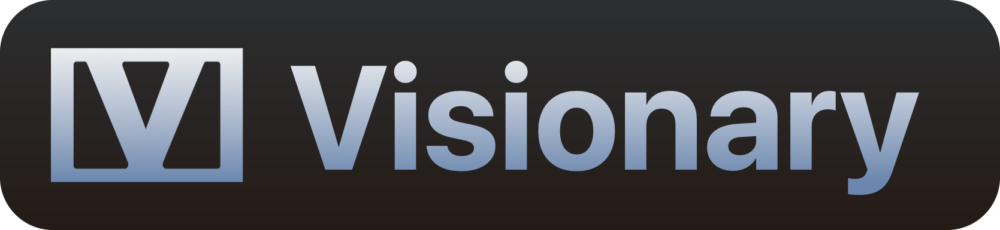
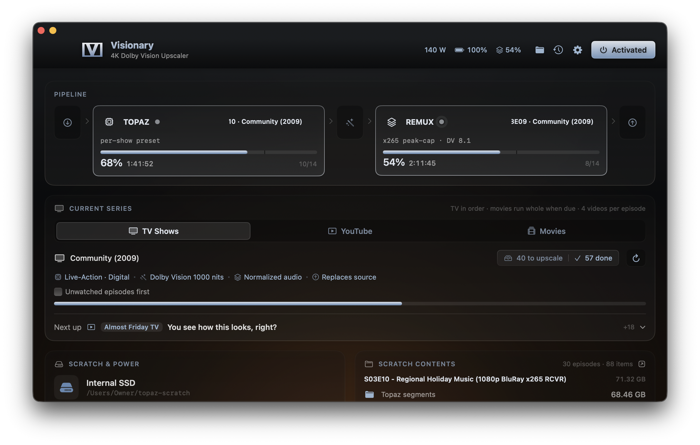
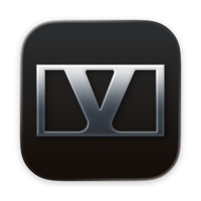

  

**Upscale your Plex library to 4K Dolby Vision™, overnight and unattended.**

Visionary is a Mac app that works through your TV shows, movies and YouTube channels one item
at a time. It upscales each one to 4K with Topaz Video AI, makes a **real Dolby Vision™ 8.1
master** of it, and files it back into your library, either in place of the 1080p original or
beside it (your choice). Then it starts the next one. It stays out of the way while someone is
watching Plex, and after a restart it picks up where it left off without redoing finished work.

**Real Dolby Vision, not an HDR filter.** Every shot of the upscaled picture is measured, and the
Dolby Vision metadata is written from those measurements by
[hdr-analyze](https://github.com/tinof/hdr-analyze) and
[dovi_tool](https://github.com/quietvoid/dovi_tool), after one fixed SDR-to-HDR colour
conversion. These tools are pinned to exact versions, because every master's colour and
metadata were checked against those versions.

**See it on real footage:** [download the sample stills](https://github.com/adamkbritsch/visionary/releases/download/samples-lost-s01e01/visionary-lost-s01e01-samples.zip)
— six moments from the pilot of *Lost*, upscaled from 1080p to 4K Dolby Vision™ and set against the
original as side-by-sides, zoomed crops and isolated frames. One 106 MB zip of the whole folder; the
HDR images are AVIF and need an HDR screen to show their highlights. Or [browse them](docs/samples/lost-s01e01).

Optional: AI border extension widens 4:3 shows to 16:9 before they are upscaled.

Turn it on in the evening and wake up to finished episodes.

  

<b>Two episodes at once</b> — S03E10 upscaling in Topaz while S03E09 is encoded beside it, each with its own progress and time estimate.

> [!IMPORTANT]
> **What you need.** Visionary runs the GPU flat out for hours, so it checks your setup when it
> starts and won't run on one that can't keep up. It tells you exactly what's missing.
>
> | Requirement | What works |
> |---|---|
> | Mac | **Any desktop Mac** (mini, Studio, iMac), or a **16-inch MacBook Pro** on its 140 W charger. A 14-inch MacBook Pro (M1/M2) or a MacBook Air can't sustain the power draw (see below). |
> | Topaz Video AI | **7.0.1**, this exact version. It's commercial software, so you need your own licence. |
> | Homebrew | Installed. Visionary's Setup uses it to install the command-line tools it needs (ffmpeg 8, x265, mkvtoolnix). The Dolby Vision™ tools come with the app. |
> | Scratch space | A **fast SSD with about 1 TB free**. The working files are very large (see [Known limitations](docs/LIMITATIONS.md)). |
> | Media | A **NAS reachable over FTP** that holds your library. Plex is **optional** (see [Configuration](docs/CONFIGURATION.md)). |
> | AI border extension | **Optional.** The free [Comfy Desktop](https://www.comfy.org/) app plus about 11 GB of models that Visionary downloads for you (see [step 11](docs/SETUP.md#11-ai-border-extension--optional-only-for-43-shows)). Without it, everything else works the same. |
>
> **Why the power rule?** Topaz pushes the GPU for hours. A desktop Mac is plugged into the
> wall, so it always qualifies. A laptop is judged by its model rather than by the charger
> plugged into it, because a 140 W charger connected to a laptop that can only draw 96 W
> still reports "140 W". A laptop too new to be on Visionary's list isn't blocked: it is
> judged by its charger instead, with a warning. On a MacBook, closing the lid pauses the run
> unless you let it stay awake, which takes one optional command (see
> [step 12](docs/SETUP.md#12-lid-closed--optional-macbook-only)).

## Install

No cloning, and almost no Terminal:

1. **Download** the latest `Visionary-vX.zip` from
   [Releases](https://github.com/adamkbritsch/visionary/releases) and unzip it.
2. **Drag Visionary.app to /Applications.** This matters: opened from anywhere else, macOS
   runs a downloaded app from a temporary read-only copy, and its permissions don't stick.
3. **Right-click → Open** the first time (the app isn't notarized; macOS asks once).
4. Install **Topaz Video AI 7.0.1**, the exact build ([where to get it](docs/SETUP.md#2-install-topaz-video-ai--exact-version)). It is licensed software; the app detects it but can't install it for you.
5. Open the **gear → Settings → Setup** section. Everything else lives there, with a
   live check beside each item: your NAS connection (plus optional extras such as Plex,
   TMDb and youtarr) and **one-click installs** for everything Visionary needs. The section
   stays open until every check is green, then tucks itself away.
6. *Optional* — want [4:3 shows widened to 16:9](docs/SETUP.md#11-ai-border-extension--optional-only-for-43-shows)?
   Install the free **[Comfy Desktop](https://www.comfy.org/)** app, **launch it once**,
   add **ComfyUI-VideoHelperSuite** from its Manager, then back in Setup use the *Border
   extender* group's one-click downloads for the ~11.4 GB of models. Skip this and the
   feature simply never appears — nothing else needs it.
7. *Optional, MacBook only* — want it to keep running with the **lid closed** and no
   screen attached? Run the one command Setup shows under *Applications & hardware → Lid
   closed* (see [step 12](docs/SETUP.md#12-lid-closed--optional-macbook-only)). It asks for your password
   once. Skip it and closing the lid puts the Mac to sleep, as usual.

Visionary won't start until the exact Topaz version and everything else it needs are in
place, and it names exactly what's missing rather than failing partway through a run. On the
NAS, only its **FTP service** needs to be on (System Settings on a UGREEN, or your NAS's
file-services panel); everything else there is optional.

## Read more

- **[Setup — manual / development path](docs/SETUP.md)**: the same install from a clone, step
  by step, each with its preflight check; the optional extras (AI border extension, lid
  closed); the repo map.
- **[How it works](docs/HOW-IT-WORKS.md)**: the stages, which path each kind of source takes,
  the Dolby Vision™ step, peak capping, audio, scheduling and the app.
- **[YouTube](docs/YOUTUBE.md)**: youtarr, channels, links and Send to Visionary, the fast
  route, and what's never processed (Shorts).
- **[Configuration](docs/CONFIGURATION.md)**: every `config.json` key and its environment
  override, and why Plex is optional.
- **[Known limitations](docs/LIMITATIONS.md)**: scratch space, the AI border extension's cost,
  an overloaded NAS, and source replacement.

Setting it up with [Claude Code](https://claude.com/claude-code)? It follows
[CLAUDE.md](CLAUDE.md) and [docs/SETUP-CLAUDE.md](docs/SETUP-CLAUDE.md).

## Legal

© 2026 Adam Britsch. Topaz Video AI, Plex, and Dolby Vision™ are trademarks of their
respective owners; you must own a license for Topaz Video AI. `dv/hdr_analyzer_mvp` is a build of
[hdr-analyze](https://github.com/tinof/hdr-analyze), © 2025 HDR-Analyze Contributors, MIT
licensed ([`dv/LICENSE.hdr-analyze`](dv/LICENSE.hdr-analyze)). `dv/dovi_tool` is
[dovi_tool](https://github.com/quietvoid/dovi_tool) 2.3.0's own release build, MIT licensed
([`dv/LICENSE.dovi_tool`](dv/LICENSE.dovi_tool)).
Use this only on content you legally own.

---

  

  Pirate ship icon by <a href="https://thenounproject.com/">Madison Apple</a> from the Noun Project, licensed under <a href="https://creativecommons.org/licenses/by/3.0/">CC&nbsp;BY&nbsp;3.0</a>.

