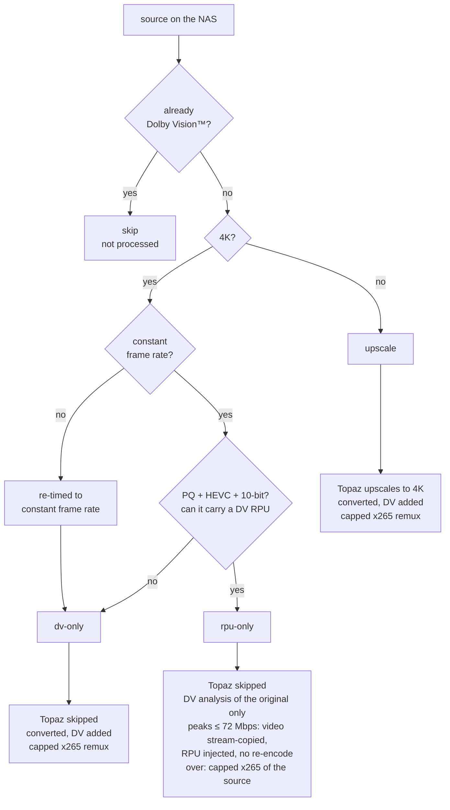
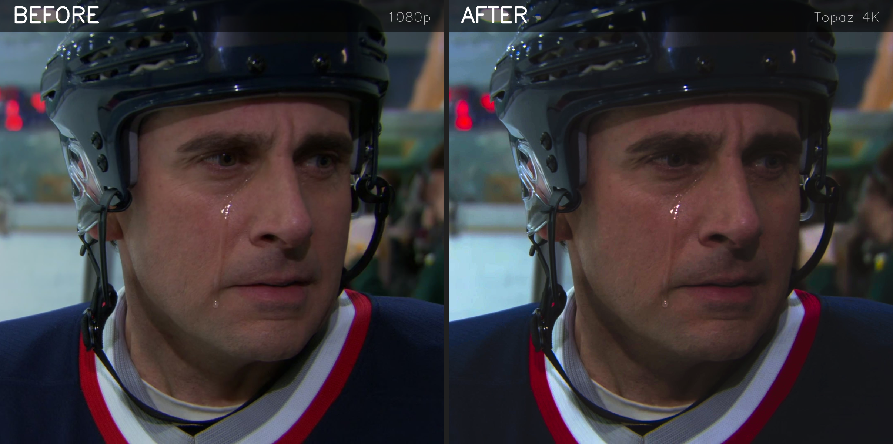
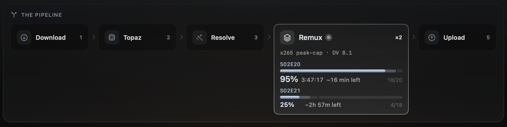
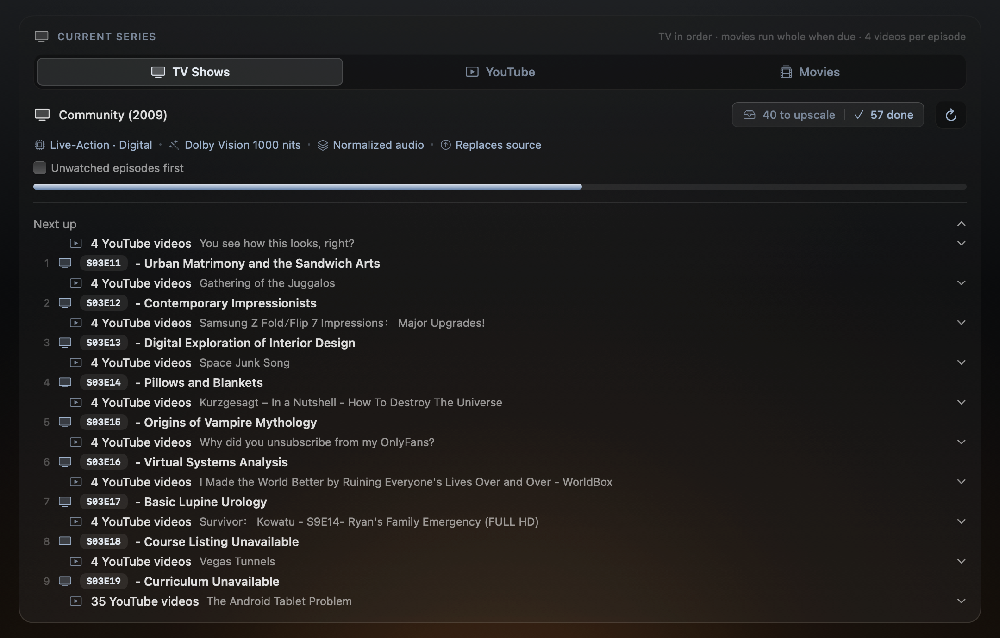
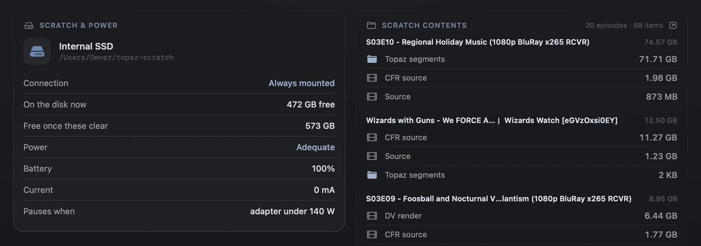
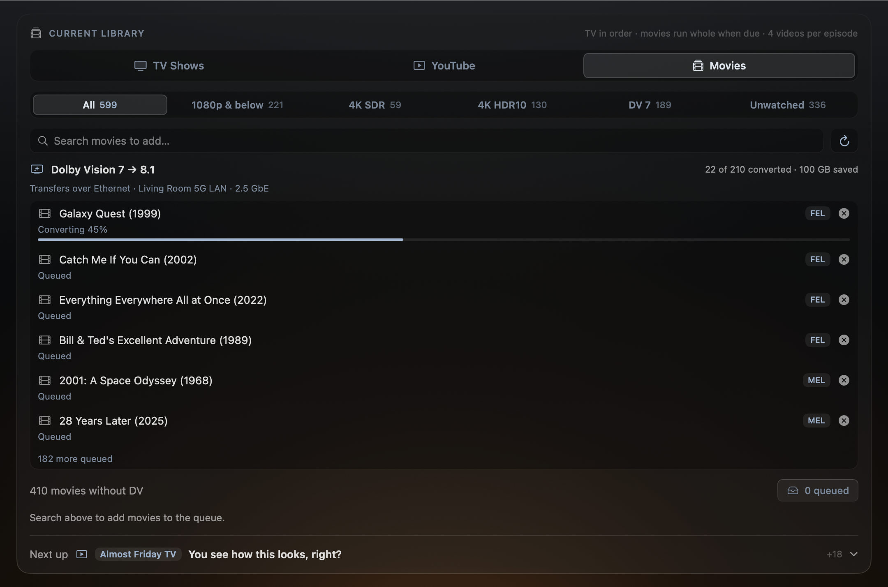
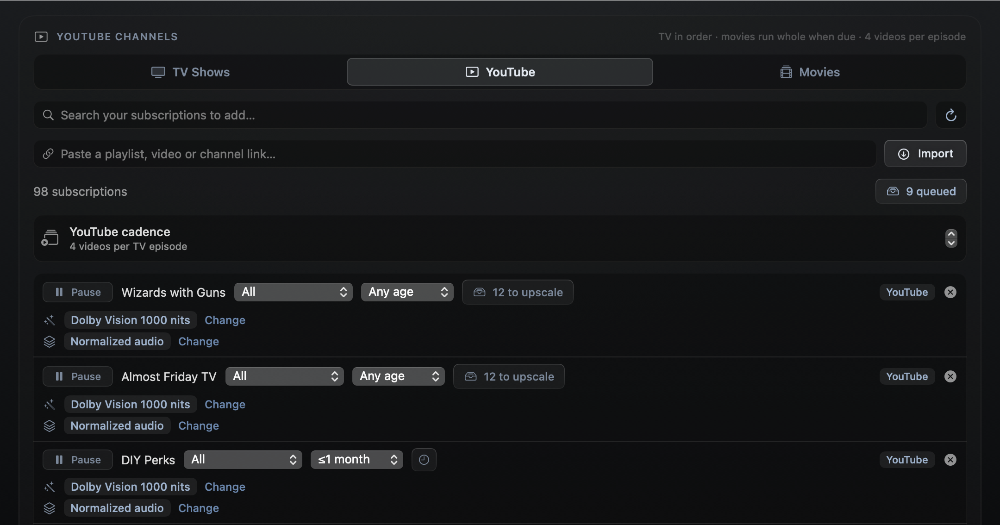

<sub>[← Visionary README](../README.md) · [Setup](SETUP.md) · [How it works](HOW-IT-WORKS.md) · [YouTube](YOUTUBE.md) · [Configuration](CONFIGURATION.md) · [Known limitations](LIMITATIONS.md)</sub>

# How it works

```
NAS (FTP) ──download──▶ local scratch
                          │  [optional, 4:3 shows only] AI outpainting — WAN 2.1 VACE via ComfyUI
                          │  extends the left/right borders to 16:9 (borders only; the original
                          │  picture is untouched). Runs alone: everything else is suspended.
                          ▼
                        Topaz Video AI (bundled ffmpeg, prob-4) — 1080p → 4K ProRes chunks
                          ▼
                        Dolby Vision™ step (headless) — the pinned SDR→PQ LUT, then hdr-analyze
                          │  measures every shot → dovi_tool writes the DV 8.1 metadata (RPU)
                          ▼
                        remux — x265 re-encode under a hard peak-bitrate cap (native DV RPU),
                          │  original audio + subtitles folded back + smart loudness boost,
                          │  muxed by mkvmerge into a Dolby Vision 8.1 MKV
                          ▼
NAS (FTP) ◀──upload─── finished 4K DV master REPLACES the source (default) or lands
                       NEXT TO it — per-show/movie "Replaces source" setting; keeping
                       both makes Plex serve them as one item with two versions
```

## Which path a source takes

Every source is ffprobed (`engine/plan.py`), and the measurements — not the filename —
decide the route. The probe always reads the untouched original, never the CFR intermediate,
so a VFR source can't sneak into a fast path via its CFR copy. The filename is only ever used
for the *suggestion* shown in the app before a file has been downloaded.



| source | Topaz | Dolby Vision™ step | remux | video re-encoded? |
|---|---|---|---|---|
| 4K HDR10 · HEVC · 10-bit | skipped | DV analysis only, 1000 nits | RPU injected onto the original | **no — bit-identical** (video peaks ≤ 72 Mbps; hotter sources take the capped x265 instead — see below) |
| 4K HDR · HLG/AV1/H.264/8-bit | skipped | converts + DV, 1000 nits | capped x265 | yes — DV 8.1 needs an HEVC PQ base |
| 4K SDR | skipped | adds HDR + DV, 1000 nits | capped x265 | yes |
| 4K, variable frame rate | skipped — only re-timed to a constant rate | adds (HDR+)DV | capped x265 | yes |
| 1080p and below | upscale to 4K | adds (HDR+)DV, 1000 nits | capped x265 | yes |
| already Dolby Vision™ | — | — | — | filtered out of the queue up front; a slip-through is refused at the Topaz stage — never mastered or uploaded |

**YouTube videos take their own route**, whatever their resolution: Topaz is skipped and
the Dolby Vision™ render does the scaling (a Lanczos fit into 3840×2160), so a video spends
minutes in the pipeline rather than hours. See [YouTube](YOUTUBE.md).

The nit ceiling is **1000 on every path** — the 2000-nit target is retired; the true-SDR
output stays a manual choice, set per show, movie or channel.

Two combinations have no path yet and are refused up front, before any upscaling, with the
reason in the log: an **HDR source pinned to SDR output** (it would need a tone map) and an **HDR
YouTube video that isn't 3840×2160** (its render would need an HDR fit). A 4K source that isn't
16:9 — 2.39:1 scope, DCI 4K — is letterboxed into 3840×2160 like every other master.

<p align="center">
  
</p>
<p align="center"><sub><b>1080p source vs Visionary's 4K master</b> — same frame, cropped equally (colour-matched to isolate the resolution gain; the master is also Dolby Vision™).</sub></p>

- **Smart upscaling profiles**: it detects how a title was actually made — **film, digital,
  or animation (2D vs CGI)** — by consulting TMDb (animation + technique) and ShotOnWhat
  (live-action film vs digital), then picks the matching tuned Topaz profile automatically,
  with per-resolution variants for 480p/720p/1080p sources. No confident match → it asks
  once, and every choice is overridable per show.

- **Dolby Vision™ mastering at 1000 nits**: every item is automatically mastered to
  **Dolby Vision™ at 1000 nits**, whatever the intake range, exported as HDR10 + Dolby
  Vision™ Profile 8.1. An SDR source goes through one pinned colour conversion (a 3D LUT,
  BT.709 SDR to BT.2020 PQ at 1000 nits); an HDR10 source keeps its own mastering, and HLG
  is converted to PQ by the standard BT.2100 conversion. Each shot's brightness is measured
  into the Dolby Vision™ metadata; the per-display trims are neutral rather than Dolby's
  licensed automatic ones, which matters mostly on screens dimmer than 1000 nits. (The old manual 2000-nit
  target is retired: an item still pinned to it masters at 1000 nits.)

- **4K fast paths**: every 4K source skips Topaz entirely, at any
  bitrate — its picture is already the deliverable. No 4K source goes through Topaz at all: a
  variable-frame-rate one is only re-timed to a constant rate (ffmpeg) first.
  Two tiers, decided by what the stream can technically carry:

  **HDR10 keeps its original bits — up to the Dolby Vision™ playback ceiling.** A 4K PQ /
  HEVC / 10-bit source keeps its **original video bits**: the picture is measured as it is
  and only the generated RPU is injected onto the original with `dovi_tool`, at any 4K geometry (2.39:1 scope and DCI 4K included). The
  coded pictures come out bit-identical; only the container and NAL scaffolding are
  rebuilt. One gate applies: players that choke on high-bitrate single-layer DV (the
  SHIELD stutters above ~80 Mbps **whole-stream** with DV engaged, though it direct-plays
  non-DV at 121 — and lossless TrueHD audio rides another 4–8 Mbps above the video, so a
  file that plays fine bare can be pushed over purely by injecting the RPU and muxing
  Atmos in). The remux therefore measures the source's 1-second video peaks first: at or
  under **72 Mbps** (80 minus TrueHD headroom — every output is budgeted as if it carries
  TrueHD) the stream ships untouched; over it, the source video takes the same
  enforced-VBV capped x265 native-DV re-encode as every other path, scene-cut segmented
  and resumable.

  **Everything else 4K** ships its HDR+DV conversion through the normal capped remux,
  whatever its bitrate (there is no minimum any more). Nothing is excluded by provenance, so a
  4K YouTube VP9 takes it too. Either way a movie lands in **~2.5× its runtime** instead of ~5×.

  An HDR source that *cannot* carry an RPU — HLG, AV1, H.264 or 8-bit — has to be converted
  to gain Dolby Vision™ at all, since DV 8.1 requires an HEVC PQ 10-bit base layer. That is
  the one case where HDR material is re-encoded, and the plan says which property forced it
  rather than doing it silently.

- **Companion combine** (needs [Shuttle](https://github.com/adamkbritsch/shuttle)'s relay):
  when a second copy of a movie sits on your seedbox, Visionary pairs the two and builds
  ONE best-of MKV — the genuinely better HDR10 video (an **IMAX edition wins outright**:
  more picture beats every other signal), a **real (studio) Dolby Vision™ RPU**
  from whichever copy carries one (grafted across releases with `dovi_tool`; Profile 7
  Blu-ray metadata is converted to 8.1, and real DV always beats a generated analysis), and
  the best lossless audio (**TrueHD Atmos** ranks first — the donor's compat AC-3 rides
  along). The movie list also shows already-DV titles — but only the ones a combine can
  still improve: a background sweep checks the seedbox, and a DV movie appears **only when
  a counterpart exists there and its audio isn't already Dolby Atmos** (goal reached =
  nothing to gain = not listed). Every
  choice is shown on a **verdict card** you approve before anything runs; the seedbox copy
  streams straight through the relay (never staged on the NAS, never modified — it keeps
  seeding), and the combined master obeys the same playback peak budget as every other
  output, taking the capped re-encode (real RPU preserved) when the winner's peaks bust it.

- **Dolby Vision™ profile 7 → 8.1, in place** (it
  reaches the NAS over Visionary's own FTP, so it works away from home too, over Tailscale): Blu-ray remuxes carry Dolby Vision™ as **profile 7**, which most
  streaming players (Google TV, Apple TV, the SHIELD in some modes) will only play as HDR10.
  The Movies pane's **DV 7** filter lists every movie known to be profile 7 — read from the
  RPU itself, since a release name says "DV" for 7 and 8.1 alike — and queues one, or all of
  them, to be converted. **Nothing is re-encoded**: the file has already proven it carries
  Dolby Vision™, so the HDR10 video is copied bit for bit, `dovi_tool` rewrites each RPU to
  8.1 (dropping the enhancement layer, MEL, FEL or a separate 1080p EL track), and
  `mkvmerge` puts every other track, chapter and attachment back unchanged. Release quirks are
  handled rather than refused: a malformed video block that ffmpeg will not extract (Risky
  Business) is pulled with mkvtoolnix's `mkvextract` instead; enhancement-layer data split off
  into blocks of its own (Star Trek: Nemesis) is handed back to its picture; and uneven frame
  times (The Mandalorian and Grogu) are carried over exactly, so the picture never drifts from
  the sound. A file that was cut short on the NAS is refused before the conversion starts, saying
  where it stops, since only a complete copy can fix it. The new file is
  verified twice (DV 8.1 side data and RPU, frame count, duration, tracks, start and end timestamps —
  on the Mac, then again on the copy read back from where it is staged on the NAS) and then
  **renamed over the original under the exact same name** and permissions, so Plex keeps the
  item, its posters and watch state, and is told to re-analyze it. No backup is kept.
  This runs beside the upscales, not in their queue: it needs no GPU, it only uses disk
  above Visionary's own free-space floor — and it **outranks the upscales' cached
  downloads**: when a movie needs room, the sources downloaded ahead for later items are
  cleared (the furthest-off first; each downloads again in its turn), and the download-ahead
  never takes the room a movie in progress still needs. A movie whose upload or swap fails gets
  **5 attempts in all** — each resuming from its converted file, after a pause that grows from
  a minute to half an hour — and when the fifth fails its files are deleted from the Mac;
  nothing that failed is left holding disk. Transfers resume after any interruption and are
  **throttled whenever anyone has a Plex session open** (the **Plex throttle** switch in Settings; off runs at full speed), a file is never replaced while it
  is being played, and Plex is told about one replaced movie at a time — once nobody is streaming and Plex has no heavy analysis running, and no movie is swapped while the last one is still settling in Plex (its chapter thumbnails and loudness pass read the whole file; back to back, they starved the NAS). Transfers also ease off while Plex is busy analyzing.

- **AI border extension — 4:3 shows to 16:9** (optional, off by default): an old 4:3 show
  can have its **left and right borders generated** by a diffusion model
  ([WAN 2.1 VACE](https://github.com/Wan-Video/Wan2.1)) instead of living in pillarboxes,
  filling a 16:9 screen before the upscale even starts.

  **Only the borders are AI.** Each 81-frame chunk is outpainted at a 480p-class working
  resolution; then *only the generated side strips* are cropped out, scaled to the source
  height, and stacked either side of the **original full-resolution frames**. Your picture
  is never round-tripped through the model, the frame count is preserved exactly, and the
  audio never goes near any of it. Topaz then upscales the widened 16:9 result to 4K like
  any other source.

  The option lives on each show's settings card and **only appears on shows that actually
  measure 4:3** (anamorphic DV included, via the sample aspect ratio) once the models are
  installed — there is nothing to see on a 16:9 library, and once a show has ANY 4:3
  episode the option stays offered even after later seasons go widescreen (It's Always
  Sunny switches at S06 — the classic case). Each episode is re-checked at run time, so
  only the actually-4:3 episodes extend: wide episodes and specials skip themselves, as do
  movies, YouTube videos and HDR sources (the model is SDR-only).

  **Continuity is engineered, not hoped for.** Chunk boundaries snap to scene cuts (a
  wing "reset" that lands on an edit is invisible) and every chunk within a scene shares
  its seed. A per-show **wing prompt** on the settings card gently biases what the wings
  contain. And a persistent **set memory**: the first time a recurring set is extended,
  its invented wings are remembered (a reference frame per set, recognized by perceptual
  hash) and fed back as VACE reference conditioning — so Paddy's Pub gets *the same*
  invented bar in every scene and every episode, not a fresh hallucination each time.
  The settings card shows how many sets a show has learned, with a Reset if the AI ever
  takes one in a direction you don't like (already-made episodes are untouched).

  It runs through **your own Comfy Desktop install, headlessly** — Visionary starts that
  ComfyUI from its own venv on a **dedicated port (8189)** and talks to the HTTP API, so
  the Comfy app you use normally, and its port 8188, are never touched. **The Comfy
  Desktop app is required** (Visionary uses the checkout, venv and models directory it
  manages, located via its own `settings.json`), as is the **ComfyUI-VideoHelperSuite**
  node, which Comfy Desktop does not bundle — install it from Manager. Setup names
  whichever piece is missing; see [step 11](SETUP.md#11-ai-border-extension--optional-only-for-43-shows).

  > [!WARNING]
  > **This is the slowest thing Visionary does — by a wide margin.** Expect *hours* per
  > episode, on top of the normal ~1h35m. It is chunked and resumable (a stop or a deploy
  > costs at most the chunk in flight), and **it takes the whole machine**: the moment
  > outpainting starts, in-flight remuxes are suspended outright (SIGSTOP — no CPU, no lost
  > work), the finisher stops taking on remux, upload *or* cleanup work, and the background
  > prefetcher stands down. Nothing else runs until the episode's borders are done. Turn it
  > on per show, deliberately.

- **Two things at once**: the heavy stages overlap — episode N's remux runs while episode
  N+1 is already in Topaz (both segmented + resumable; a deploy or power loss costs at
  most one ~5-minute segment). Measured on real episodes, the overlap cuts a finished
  episode from ~3h12m to ~2h20m — **~27% faster (≈52 minutes saved per episode)**. Those are
  the ~30-minute extended-cut episodes in the test library; that's about **4.9 minutes of
  wall-clock per minute of content**, so a standard **20-minute 1080p episode** comes out a
  finished 4K Dolby Vision™ master in **roughly 1h35m** (measured median across 65 finished
  episodes). And if two finished upscales are ever waiting at once, **both remux in
  parallel** on a second lane (Topaz pauses until a lane frees, so the two x265 encodes
  get the machine). High-bitrate fast-path items don't serialize either: while one is
  remuxing, the next item starts — its Dolby Vision™ step included. Simultaneous remuxes
  stay capped at two. The AI border extension takes the whole machine: the in-flight remuxes
  are **suspended outright** the instant it starts (SIGSTOP, so they use no CPU) and resume
  exactly where they were, and it also halts uploads, cleanup and the prefetcher, so nothing
  whatsoever overlaps it.

<p align="center">
  
</p>
<p align="center"><sub><b>Both remux lanes live</b> (an earlier build's pipeline card) — each names its own episode and carries its own progress, segment counter and ETA. Lane 2 shows no elapsed clock because the engine keeps that bookkeeping on lane 1 only.</sub></p>

- **Storage-smart output**: the remux stage re-encodes the multi-gigabyte Dolby Vision™ render
  under a hard peak-bitrate cap (x265 with a 50 Mbps ceiling on any one second), so a finished 4K
  Dolby Vision™ master averages **~1.4 GB — only ~1.7× the ~0.8 GB 1080p source**
  (measured across 48 upscaled episodes). A per-show/movie **"Replaces source"** setting
  decides the source's fate: replace (default — deleted only after the master
  size-verifies on the NAS) or keep it beside the master, where Plex serves both as one
  item with two versions and the source stays re-runnable by future, better models.
  If a master still measures over the cap, the remux **repairs itself**: it localizes the
  offending second(s), re-encodes only those segments at a tighter cap (85%, then 70%),
  and re-gates — instead of failing on identical retries.

- **Appliance mode**: once Activated it re-arms itself across launches and stops; it
  pauses on battery and dims the screen after idle. Nothing it does needs the screen or
  the mouse, so the Mac stays usable while it runs. It pauses its NAS precaching whenever a
  Plex stream is live, so pulling ahead can't stutter playback.

- **TV + Movies** are the core; **YouTube mode** is optional (requires youtarr on the NAS).
  Everything YouTube is described in [YouTube](YOUTUBE.md).

| Round-robin queue | Guardrails |
|:---:|:---:|
|  |  |
| <sub>Pick shows, keep <b>unwatched first</b>, round-robin several series; movies and YouTube slot in on their own cadence. A show's featurettes always run after its episodes, and a per-show <b>Upscale featurettes</b> toggle skips them entirely. While the pipeline is armed the per-item settings condense to <b>one line</b> — they can't change mid-run — but you can still queue more work, and drag a movie to whichever slot you want it to run in.</sub> | <sub>The <b>140 W power gate</b> and free-space headroom, plus live per-episode scratch usage broken out by artefact (Topaz segments, DV render, CFR source, source).</sub> |

| Movies | YouTube |
|:---:|:---:|
|  |  |
| <sub>Movies run whole when they come due. The filters say what each source is — <b>1080p & below</b>, <b>4K SDR</b>, <b>4K HDR10</b>, <b>DV 7</b>, <b>DV 8.1</b> — and a profile 7 movie goes to the <b>Dolby Vision™ 7 → 8.1</b> lane: converted in place with no re-encode, over the Ethernet, one transfer at a time (here 22 of 210 done). A queued movie shows its <b>resolved</b> output mode rather than "auto" — everything lands on <b>1000 nits</b> unless pinned to SDR (the 2000-nit target is retired). The count is how many of your library's titles still have no DV.</sub> | <sub>Optional. Pulls from your own subscriptions and slots videos in on a cadence you set (here <b>4 per TV episode</b>), with per-channel scope and age filters. Channels can be paused individually.</sub> |
